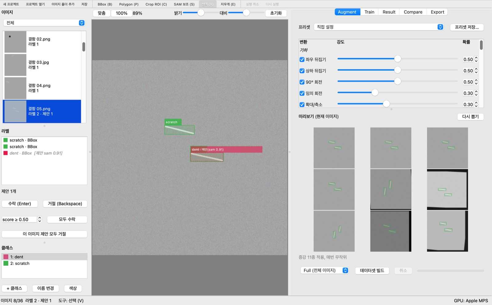
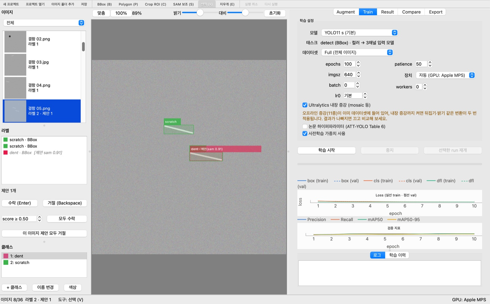
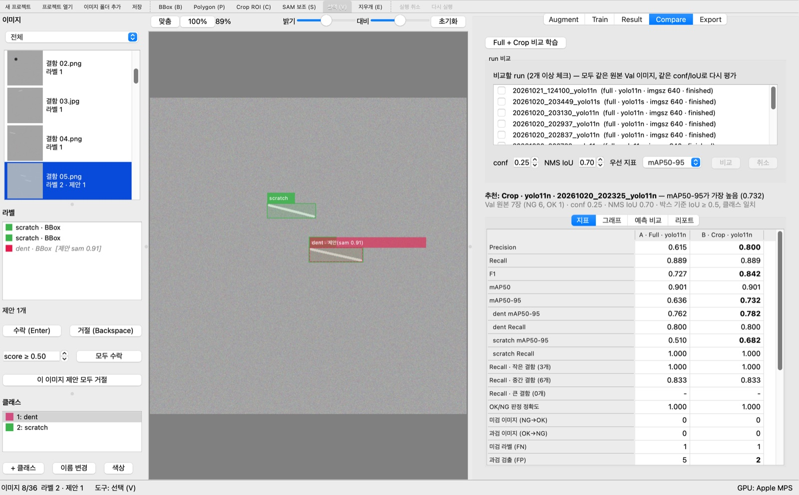
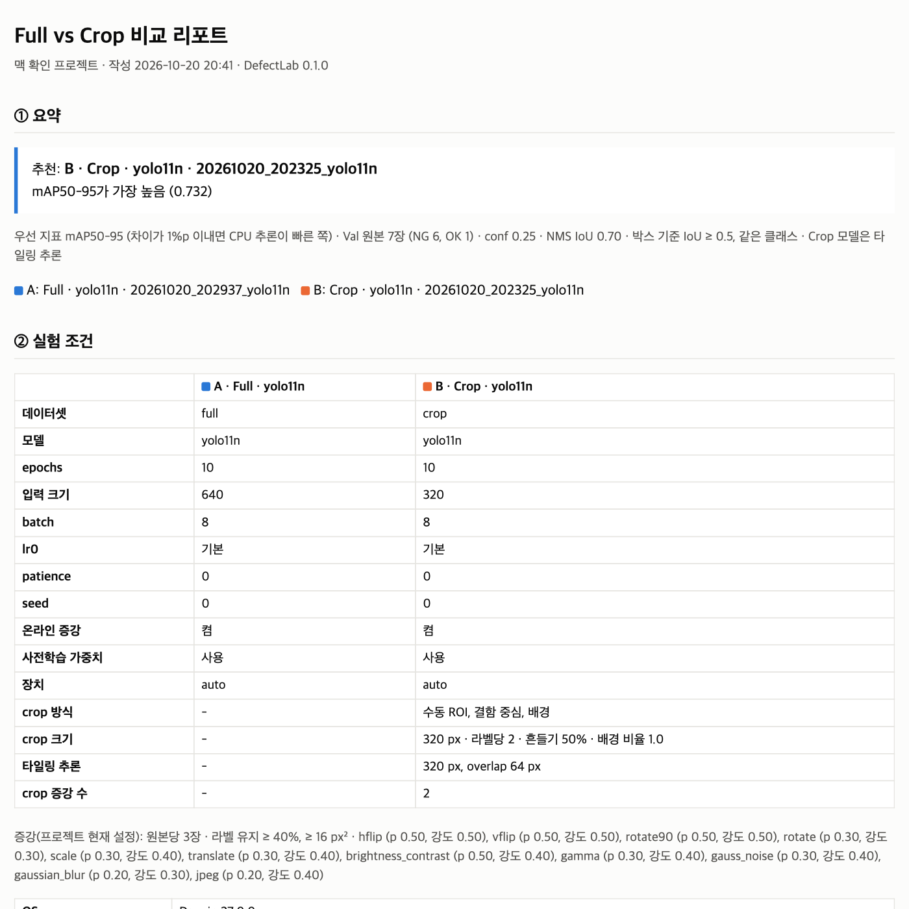
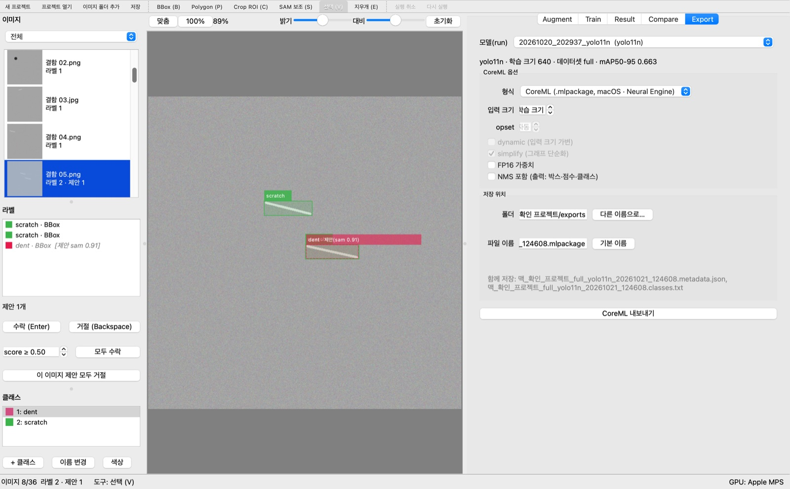

# macOS (Apple Silicon) 확인 체크리스트 — 실제 M1 확인 결과

`docs/mac_checklist.md`의 항목을 실제 M1 Mac에서 확인한 기록이다 (2026-10-20 ~ 21).
앱(`python -m defect_inspection.app`)은 실제 Cocoa 화면에 띄웠고(offscreen 아님), 스크립트가 진짜 `MainWindow`와 각 탭을
조작했다. 마우스 드래그와 키 입력은 QTest로, 학습은 Train 탭의 실제 QProcess worker로, 내보내기는 Export 탭으로 했다.
테스트 폴더는 공백과 한글이 들어간 `~/Documents/검사 데이터/샘플 이미지`, 프로젝트는 `~/Documents/검사 데이터/맥 확인 프로젝트`를 썼다.

표시: `[x]` 확인됨 · `[ ]` 문제 있음 · `[~]` 일부만 확인 · **(사람 확인 필요)** 스크립트로는 확인할 수 없는 항목

**테스트 데이터**: 640×640 합성 결함 이미지 24장(PNG·JPEG, 원형 `dent` / 선 `scratch`, 이미지당 결함 1~2개),
정상 4장, 16bit TIFF 2장 (총 30장, Val 비율 0.25). 증강은 원본당 3장, Crop은 320px·증강 2장이다.

## 요약

- 앱 전체 흐름(라벨링 → SAM → 증강 → MPS 학습 → 결과·비교·리포트 → ONNX/CoreML 내보내기 → .app/.dmg)이 M1에서 동작한다.
- **MPS 학습은 CPU보다 1.84배 빠르다** (yolo11n 640px, 앱 학습 기준). 벤치마크로는 2.44배다.
- **MLX는 진행하지 않는다**: 학습 1 step에서 MLX가 MPS의 0.59배 속도다 (기준 1.5배 미만).
- 확인 중 발견해 **수정한 문제** 3개:
  1. CoreML 내보내기 실패 (NumPy 2.4 + coremltools 9.0) → `pyproject.toml`에 `numpy<2.4` 고정
  2. 설치본에서 학습을 시작할 때마다 matplotlib 폰트 캐시를 다시 만듦 (한 번은 몇 분 멈춤) → `platform_utils.use_persistent_matplotlib_cache()`
  3. Mac에서만 실패하던 테스트 2개 (Mac 분기를 고려하지 않음) → 테스트 수정
- 화면 문제(다크 모드 글자, SAM 태그, 메뉴, 창 최소 크기, 그레이 CoreML 안내)도 이어서 수정했다 (아래 "발견 사항" 4~8번). 9·10번은 관찰만 했다.

## 1. 설치
- [x] `torch.backends.mps.is_available()` → `True`
- [x] `pip install -e ".[dev]"` 오류 없음 (uv 사용, `.[dev,bench,package]`)
- [x] `--self-check` → 9개 모두 `[OK]`, "계산 장치: GPU: Apple MPS → … 'mps'", "한글 폰트: Apple SD Gothic Neo", "Mac (MPS·CoreML): coremltools 9.0, MPS 연산 OK"
- [x] `python -m pytest` → **603 passed, 1 skipped** (수정 후). 처음에는 Mac 분기를 고려하지 않은 테스트 2개가 실패해서 고쳤다:
  `test_trainer.py::test_windows_uses_few_dataloader_workers` (Mac은 workers 0), `test_train_panel.py::test_device_detection_enables_gpu` (Mac GPU 항목은 `"mps"`)
- [x] 상태바 오른쪽에 "GPU: Apple MPS"

메모: macOS 27.0.1 (26A434) · Apple M1 · 메모리 8 GB · Python 3.12.15 (uv) · torch 2.14.1 · torchvision 0.29.1 · ultralytics 8.4.183 ·
PySide6 6.12.0 · numpy 2.3.5 · coremltools 9.0 · onnxruntime 1.31.0 · MLX 0.32.4.
처음 있던 `.venv`는 Python 3.10 기반이었고, scipy 1.15.3 `.so`를 이 macOS에서 불러오지 못해 albumentations·coremltools import가 실패했다
(self-check 2개 FAIL). Python 3.12로 venv를 다시 만들어 해결했다.

## 2. 화면과 단축키 (⌘)
- [~] 한글 깨짐 없음, Retina 배율 2.0 (`devicePixelRatio`). 화면 캡처에서 메뉴·탭·라벨 모두 정상이다. 육안 선명도는 **(사람 확인 필요)**.
  - 다크 모드 문제: 이미지 목록에서 선택하지 않은 항목의 글자("결함 02.png / 라벨 1")가 어두운 배경 위의 어두운 글자라 거의 보이지 않는다 (라이트 모드에서는 정상).
  - SAM 제안 라벨 태그 "dent · 제안(sam 0.91)"은 배경 박스가 글자보다 훨씬 넓고, "dent ·"와 "제안" 글자가 겹쳐 그려진다.
  - → 두 문제 모두 수정했다 (발견 사항 4·5번). 앱만 다크 모드로 띄워 다시 확인: 이미지 목록 글자와 태그가 정상이다.
- [ ] **메뉴에 단축키 표시**: 메뉴바에는 "설정" 메뉴 하나뿐이다 (SAM 모델…, 자동 저장 간격…, 내보내기 파일명 패턴…). 새 프로젝트·열기·저장 등은 툴바에만 있어서 메뉴에 ⌘ 단축키가 보이지 않는다.
  단축키 자체는 ⌘로 등록되어 있다: 새 프로젝트 ⌘N, 열기 ⌘O, 저장 ⌘S, 이미지 폴더 추가 ⌘I, 실행 취소 ⌘Z, 다시 실행 ⇧⌘Z / ⌘Y.
  → 수정: 메뉴바에 파일 / 편집 / 보기 / 도구 / 설정 메뉴가 생겨 위 단축키가 메뉴에 표시된다.
- [x] ⌘0 화면 맞춤, ⌘1 실제 크기. 툴팁에 "화면에 맞춤 (⌘0)", "실제 크기 (⌘1)"로 표시된다.
- [x] 도구 단축키 B / P / C / S / V / E 등록 확인. ⌫로 선택한 라벨 삭제 확인 (`BACKSPACE_DELETES_SELECTION`). "라벨 삭제" 단축키는 ⌦ (fn+⌫)로 표시된다. A/D 이전·다음 이미지 등록 확인.
- [~] 확대·이동: 휠 이벤트로 확대(1.04 → 1.30배), ⌘1로 1.0배, 스페이스+드래그로 화면 이동(스크롤 위치 변화) 확인. 실제 트랙패드 두 손가락 제스처는 **(사람 확인 필요)**.
- [~] 창 크기 유지: 1400×820으로 바꾸고 다시 열면 1400×893으로 열린다 (폭은 유지, 높이는 73 px 다름 — 제목줄·최소 크기 영향으로 보임).
  → 원인은 창 최소 크기(1364×893)였고 수정했다 (발견 사항 8번). 수정 뒤 1400×820이 그대로 복원된다.
  설정 파일은 `~/Library/Preferences/com.defectlab.DefectLab.plist`이다 (Qt 기본 `QSettings`). 체크리스트에 적힌 `~/Library/Application Support/DefectLab/`에는 증강 프리셋 같은 `config_dir()` 파일만 들어간다.

## 3. 라벨링과 SAM 보조
- [x] 한글·공백 경로에 새 프로젝트, JPEG·PNG·16bit TIFF 30장 추가, 썸네일 캐시 `~/Library/Caches/DefectLab/thumbs` 생성.
  16bit TIFF는 `uint16`으로 읽혀 캔버스에 표시된다.
- [x] BBox(마우스 드래그) / Polygon(클릭 3번 + Enter) / Crop ROI(드래그) 그리기, 실행 취소·다시 실행, 저장 후 다시 열기 (라벨과 `crops.json` 유지).
- [x] SAM 보조(S): 처음 선택하면 `mobile_sam.pt`(38.8 MB)를 `~/Library/Caches/DefectLab/weights/`로 다운로드한다. SAM 장치는 `mps`.
  이미지 준비 시간 **5.4 초** (첫 실행, 다운로드 포함) / **1.5 초** (가중치가 있을 때).
- [x] SAM 클릭 → 제안 표시까지 **0.06~0.08 초** (MPS, 첫 클릭만 0.7~4.0 초). 수락 Enter / 거절 ⌫ 동작.
- [x] SAM 결과 모양: scratch 정답 박스 (321, 303)–(431, 333)에 대해 제안 (323, 304)–(429, 332), score 0.91. 마스크가 깨지거나 비어 있지 않다.

## 4. 증강·데이터셋
- [x] Augment 미리보기 9장 표시 (1초 이내).
- [x] Full 빌드 2.0 초 (Train 23장 + 증강 69장, Val 7장). Crop 빌드 2.2 초 (Train crop 102개 + 증강 204개, Val crop 32개).
  빌드 시작 직후 취소하면 `cancelled`로 멈춘다.

## 5. MPS 학습 (가장 중요)
- [x] Train 탭 장치 목록: "자동 (GPU: Apple MPS)", "CPU", "Apple GPU (MPS)". DataLoader workers 기본값 0.
- [x] 장치 "자동"으로 yolo11n, imgsz 640, 10 epoch 학습 완료. 로그에 `device=mps`, "torch-2.14.1 MPS (Apple M1)" 표시.
- [x] 같은 데이터로 장치 "CPU" 10 epoch 학습해 시간 비교 (batch 8, Train 92장 · Val 7장, Train 탭에서 시작, 같은 조건 2회차 측정):

| 설정 | epoch당 시간(초) | 최종 mAP50-95 |
| --- | --- | --- |
| yolo11n · MPS | 10.4 | 0.657 |
| yolo11n · CPU | 19.2 | 0.636 |
| yolo11s · MPS | 20.2 | 0.660 |
| att-yolo-n · MPS (선택) | 15.3 | 0.0006 (10 epoch로는 학습 부족, 기본값은 300 epoch) |
| (참고) yolo11n · MPS · Crop 320px | 11.1 | 0.695 (Crop 데이터셋 자체 val) |

  - yolo11n은 MPS가 CPU보다 **1.84배** 빠르다. epoch당 시간은 2번째 epoch부터 마지막 epoch까지의 평균이다.
  - yolo11s를 **처음** 학습할 때 첫 epoch가 **680 초** 걸렸다 (이후 epoch는 약 22 초). 같은 설정으로 다시 학습하니 첫 epoch가 27.6 초라 재현되지 않았다.
    메모리 8 GB에서 swap이 쓰이고 있었고, 첫 MPS 커널 준비가 겹친 것으로 보인다.
  - 1회차 측정(앱 프로세스 안에서 `ioreg`로 GPU 사용률을 3초마다 조회)은 epoch당 18.9~40 초로 느리게 나왔다. 측정 방법이 학습을 방해한 것이라 위 표에서는 뺐다.
- [~] 학습 중 다른 탭 사용: UI 응답 지연 p95 7~11 ms, 최대 0.2~0.75 초 (epoch 끝 그래프 갱신 때). 끊김 없음.
  GPU 사용: `ioreg`의 "Device Utilization %"가 학습 중 최대 100%. Activity Monitor 화면은 **(사람 확인 필요)**.
- [x] 중지 → 재개: 2 epoch 뒤 중지 → 학습 이력에 "중지됨 (재개 가능)", 재개 버튼 활성 → 재개 후 6/6 완료. epoch 이벤트 1~6이 빠짐·중복 없이 이어지고 그래프 데이터도 1~6으로 이어진다.
- [x] "MPS fallback" 경고 없음. 대신 매 run마다 `scatter_reduce_mps`, `index_put_with_accumulate_mps`가 "deterministic 구현이 없다"는 UserWarning이 나온다 (`deterministic=True, warn_only` 때문이며 CPU fallback은 아님).
- [x] Crop 데이터셋으로 학습 완료 (yolo11n, 320px, 10 epoch).
- 참고: 1 epoch 동안 Train 탭 그래프 영역이 낮아 (창 높이 900 px) 곡선이 거의 평평하게 보인다.

## 6. 결과·비교·Export
- [x] Result 탭: Val 그리드 7장, 1.9 초 ("맞음 8, 오검 5, 미검 1 · precision 0.62, recall 0.89").
  이미지 끌어다 놓기 추론 동작 ("결함 10.png · 검출 4개"). Crop run은 "타일링 추론 (타일 320px, overlap 64px)"으로 표시된다.
- [x] 자동 라벨 제안: 새 미라벨 이미지 3장 → 3장 모두에 제안 3개 생성.
- [x] Compare 탭: Full vs Crop 비교 5초, "추론 시간 GPU" 행이 있다 (MPS). Full 모델은 **GPU 22.1 ms vs CPU 58.4 ms → 2.6배**.
  Crop 모델(타일링)은 GPU 172 ms vs CPU 174 ms로 차이가 없다 (작은 타일을 여러 번 추론해 호출 오버헤드가 큼).
  추천: Crop · yolo11n (mAP50-95 0.732 vs Full 0.636).
- [x] HTML 리포트 저장 (`reports/20261020_2038_full_vs_crop.html`, 630 KB, PNG 그래프 5개 + JPEG 예시 10개, UTF-8).
  Safari와 같은 WebKit 엔진(Quick Look)으로 렌더링해 한글·표·그래프가 정상임을 확인했다. Safari 앱에서 직접 열어 보지는 않았다.
- [x] Export: ONNX 저장, 검증 ✓ PASS (최소 IoU 1.0000, 점수 차이 0.0000, 검증은 CPU), `.metadata.json`·`.classes.txt` 생성.
  Crop 모델 metadata에 `crop.tiling` (tile_size 320, overlap_px 64, 병합 규칙 설명)이 들어간다.
- [x] FP16 옵션 비활성 ("FP16 (GPU 필요)", 툴팁 "GPU가 없어 FP16 내보내기를 쓸 수 없습니다").

## 7. CoreML 내보내기 (22단계)
- [x] Export 탭 "형식"에 "CoreML (.mlpackage, macOS · Neural Engine)"이 있다.
- [x] CoreML로 바꾸면 이름이 `….mlpackage`, 버튼이 "CoreML 내보내기", 옵션 상자가 "CoreML 옵션"으로 바뀌고 opset·dynamic·simplify가 꺼진다. FP16 체크박스는 "FP16 가중치"로 바뀌어 활성화된다.
- [x] 내보내기 완료, 검증 ✓ PASS (PyTorch 6개 / Core ML 6개 검출, 최소 IoU 1.0000), 10.6 MB, 2.6 초. `.metadata.json`·`.classes.txt` 생성.
  **처음에는 실패**했다: `TypeError: only 0-dimensional arrays can be converted to Python scalars`.
  coremltools 9.0이 크기 (1,) 배열에 `int()`를 쓰는데 NumPy 2.4부터 이것이 오류가 된다 (torch 2.7로 바꿔도 같았고, NumPy 2.3.5로 바꾸니 해결).
  → `pyproject.toml`에 `numpy<2.4` 고정.
- [x] NMS 포함 + FP16 가중치: 검증 PASS (최소 IoU 0.9667, 점수 차이 최대 0.035), 5.4 MB. ATT-YOLO도 CoreML 내보내기 성공 (24.8 MB, 단 10 epoch 모델이라 검출 0개끼리 비교).
- [ ] Xcode Performance 탭에서 Neural Engine 사용 확인 (선택) — **(사람 확인 필요)**, Xcode로 확인하지 않음.
  참고로 벤치마크에서 ONNX Runtime CoreML provider 8.3 ms, `.mlpackage` 10.1 ms (PyTorch MPS 20.6 ms)라 가속은 되고 있다.
- [~] 그레이스케일 프로젝트: 안내 문구 "CoreML 내보내기는 컬러(3채널) 모델만 지원합니다. 그레이 모델은 ONNX로 내보내세요"가 나온다.
  하지만 미리 알려 주지 않는다. 형식을 CoreML로 골라도 `problem()`은 None이고, 내보내기 버튼을 누른 뒤에야 "ValueError: …" 오류 창과 "내보내기 실패" 문구로 나온다.
  → 수정: CoreML을 고르는 즉시 안내 문구가 나오고 내보내기 버튼이 꺼진다.

## 8. Mac 설치본 (.app / .dmg, 22단계)
- [x] `.[package]` 설치 후 `packaging/build_mac.sh` → ad-hoc 서명, 서명 확인 OK, 설치본 self-check 9개 `[OK]` + `--train-worker` OK, `dist/DefectLab-macos-arm64.dmg` 생성.
  (경고만 있음: `lap`, `jupyter_rfb`, `tensorflow`, `tensorboard`, `OpenGL` 하위 모듈 수집 실패 — 쓰지 않는 선택 기능이다.)
- [ ] 다른 Mac(또는 다른 사용자 계정)에 .dmg 복사 → Applications로 끌어다 놓기 — **(사람 확인 필요)**
- [ ] 첫 실행 Gatekeeper 경고 → README 안내대로 열기 — **(사람 확인 필요)** (같은 Mac에서 빌드한 앱은 quarantine 속성이 없어 확인할 수 없다)
- [~] 설치본 핵심 동작: 설치본 self-check(ONNX 내보내기·MPS·CoreML 모듈 포함) 통과, 설치본 worker(`DefectLab --train-worker`)로 MPS 3 epoch 학습 완료(71 초).
  설치본 창에서의 라벨링·비교 리포트·CoreML 내보내기는 직접 확인하지 않았다 (소스 실행으로만 확인).
  - **발견 후 수정**: 첫 설치본 학습이 "Matplotlib is building the font cache"에서 CPU 0%로 10분 넘게 멈췄다 (재현되지는 않음).
    원인은 PyInstaller의 matplotlib 런타임 훅(`pyi_rth_mplconfig`)이 실행할 때마다 `MPLCONFIGDIR`를 새 임시 폴더로 바꾸는 것이다.
    그래서 앱을 켜거나 학습을 시작할 때마다 폰트 캐시를 처음부터 다시 만들었다 (self-check "한글 폰트" 20 초, 학습 시작 전 약 15 초 대기).
    → `app.main`/`worker_entry`가 `platform_utils.use_persistent_matplotlib_cache()`로 `~/Library/Caches/DefectLab/matplotlib`을 쓰도록 수정.
    다시 빌드해 확인: self-check "한글 폰트"는 첫 실행 14.8 초 → 다음 실행부터 0.0 초 (self-check 전체 4~5 초).
    설치본 worker 학습의 첫 epoch 완료 시점은 41 초 → 15 초로 줄었고, 로그에 "building the font cache"가 더 나오지 않는다.
- [x] 학습 중 Dock에 아이콘이 더 생기지 않음 (학습 중 `lsappinfo list`에 DefectLab 0개 — worker는 GUI 앱으로 등록되지 않는다).
- [x] 앱 크기 **1.0 GB**, .dmg 크기 **0.42 GB** (416 MB).

## 9. 가속 측정 → MLX 진행 여부 (22단계)
- [x] `.[bench]` 설치 (MLX 0.32.4) 후 `python tools/bench_apple.py --json bench.json` (결과: `mac_check_images/bench.json`)
- [x] 결과 표:

**1. 학습** (YOLO11n, 이미지 64장, 640px, batch 16)

| 장치 | epoch당 초 |
| --- | --- |
| CPU | 11.46 |
| MPS | 4.69 |

MPS가 CPU보다 2.44배 빠르다.

**2. 추론** (1장, 640px, 네트워크만 — 전처리·NMS 제외, 중앙값)

| 방식 | ms/장 |
| --- | --- |
| PyTorch CPU | 46.55 |
| PyTorch MPS | 20.63 |
| ONNX Runtime CPU | 31.73 |
| ONNX Runtime CoreML | 8.33 |
| CoreML .mlpackage | 10.12 |

**3. 학습 1 step** (forward + backward + SGD, batch 8, 640px)

| 구현 | ms/step |
| --- | --- |
| PyTorch CPU | 1483.6 |
| PyTorch MPS | 464.5 |
| MLX | 988.5 |
| MLX (mx.compile) | 792.5 |

- [x] **판단**: MLX가 MPS 대비 0.59배 (기준 1.5배 미만) → **MPS 유지, MLX 학습 엔진은 진행하지 않음**

## 10. 알려진 제한 (확인만)
- 원본 체크리스트와 같다. 덧붙일 점: 메모리 8 GB M1에서는 yolo11s 첫 학습 때 swap이 쓰였다. 더 큰 모델(yolo11m, att-yolo-s, 1280px)은 batch를 줄여야 할 수 있다 (확인하지 않음).

## 발견 사항 정리

| # | 내용 | 상태 |
| --- | --- | --- |
| 1 | CoreML 내보내기가 NumPy 2.4에서 실패 (coremltools 9.0) | 수정: `numpy<2.4` 고정 |
| 2 | 설치본이 시작할 때마다 matplotlib 폰트 캐시 재생성, 한 번은 학습 시작이 10분 넘게 멈춤 | 수정: `use_persistent_matplotlib_cache()` (다시 빌드해 확인) |
| 3 | Mac 분기를 고려하지 않은 테스트 2개 실패 | 수정 |
| 4 | 다크 모드에서 이미지 목록의 선택하지 않은 항목 글자가 거의 안 보임. 원인: 라벨 있는 항목에 `setForeground(QColor())` → 무효 색 = 검정 | 수정: 색 역할을 비워 팔레트 글자색 사용 |
| 5 | SAM 제안 라벨 태그: 배경 폭이 글자보다 넓고 글자가 겹침. 원인: (1) 앱 생성 전에 만든 `QFont`(family 없음)로 폭 측정 → 129 px vs 실제 93 px, (2) 반투명 태그 아래로 같은 위치의 확정 라벨 태그가 비침 | 수정: `tag_font()`를 앱 생성 뒤 만들어 측정·그리기에 같이 쓰고, 태그 배경을 불투명에 가깝게 |
| 6 | 메뉴바에 파일/편집 메뉴가 없어 메뉴에 ⌘ 단축키가 표시되지 않음 (툴바에만 있음) | 수정: 파일 / 편집 / 보기 / 도구 메뉴 추가 (툴바와 같은 QAction) |
| 7 | 그레이 프로젝트에서 CoreML을 고르면 미리 막지 않고, 내보내기 뒤 "ValueError" 오류 창으로 알림 | 수정: 형식을 고르는 즉시 안내 문구 표시, 내보내기 버튼 비활성 |
| 8 | 레이아웃 복원 시 창 높이가 73 px 다르게 열림. 원인은 복원이 아니라 **창 최소 크기 1364×893** (Augment 탭만 ~810 px). 이 Mac의 사용 가능 화면 1440×870보다 높아 13인치 MacBook에서 창이 화면에 다 안 들어감. 설정 파일 위치도 체크리스트 설명과 다름 | 수정: 오른쪽 탭을 세로 스크롤 영역에 넣음(`ScrollTabs`) → 최소 크기 약 1390×628, 1400×820 저장·복원 그대로. 설정 위치는 문서(체크리스트·README·CLAUDE.md)를 실제(`~/Library/Preferences/com.defectlab.DefectLab.plist`)에 맞춤 |
| 9 | yolo11s 첫 학습의 첫 epoch 680 초 (재현 안 됨, 8 GB swap 의심) | 관찰만 |
| 10 | Crop 모델 타일링 추론은 MPS 이득 없음 (172 vs 174 ms) | 관찰만 |
